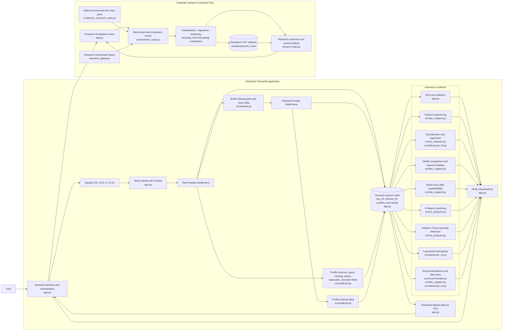

# RetailIQ architecture

Uploaded working data, profiles, filters, and interactive analysis results are held in Streamlit session state; the application does not persist uploads to a database. Interactive visualizations are rendered in the app, and filtered data can be downloaded by the user as CSV. Research evaluation is a separate benchmark workflow: it reads from `research_datasets/`, writes evaluation CSV files under `results/research_suite/`, and displays its summary and saved artifacts in the app.
